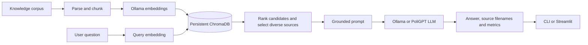

# DNI Valencia RAG Assistant

An educational retrieval-augmented generation (RAG) project that answers
questions about the Spanish non-profit **Damos Nuestra Ilusión (DNI Valencia)**
using a local knowledge corpus. It combines Ollama embeddings, ChromaDB
similarity search, and an Ollama or OpenAI-compatible language model.

This is an educational demonstration, not a production-ready service. The prompt
asks the model to stay grounded in retrieved sources and decline unsupported
questions, but an LLM can still produce inaccurate answers. Always verify
important information against the cited source documents.

## Features

- Hybrid chunking for question-and-answer files and narrative documents.
- Persistent ChromaDB vector index with cosine distance.
- Nomic embedding task prefixes for document and query embeddings.
- Retrieval of multiple candidates followed by source-diverse selection.
- Source filenames, retrieved text, latency, and token metrics in the response.
- Command-line interface and Streamlit chat interface.
- Ollama for local inference, with an optional OpenAI-compatible PoliGPT backend.
- A 12-question benchmark runner covering factual questions, synthesis,
  contradictions, and out-of-scope questions.

## Architecture



The corpus is indexed lazily on the first query and the generated vector store
is persisted locally in `chroma_db/`. The project does not maintain
conversational memory; each question is handled independently.

## Technology

- Python 3.10+
- Ollama: `qwen2.5:7b` for generation and `nomic-embed-text` for embeddings by
  default
- ChromaDB 1.x
- LangChain text splitters
- Requests and the OpenAI Python client
- Streamlit

## Getting started

### Prerequisites

1. Install Python 3.10 or later.
2. Install [Ollama](https://ollama.com/) and make sure its service is running.
3. Pull the default models:

   ```powershell
   ollama pull qwen2.5:7b
   ollama pull nomic-embed-text
   ```

### Install dependencies

Clone the repository and create a virtual environment:

```powershell
git clone https://github.com/pabloescriva12/agente-rag.git
cd agente-rag
python -m venv .venv
```

Activate it and install the dependencies:

```powershell
# Windows PowerShell
.\.venv\Scripts\Activate.ps1

# macOS / Linux (use this instead of the Windows command)
# source .venv/bin/activate

python -m pip install --upgrade pip
pip install -r requirements.txt
```

### Configure environment variables

The default configuration uses Ollama on the local machine and requires no API
key. To customize it, copy `.env.example` to `.env` and edit the values:

```powershell
Copy-Item .env.example .env
# macOS / Linux: cp .env.example .env
```

```dotenv
LLM_BACKEND=ollama
OLLAMA_URL=http://localhost:11434/api
LLM_MODEL=qwen2.5:7b
EMBED_MODEL=nomic-embed-text

# Optional OpenAI-compatible backend:
# LLM_BACKEND=poligpt
# POLIGPT_BASE_URL=https://api.poligpt.upv.es/v1
# POLIGPT_API_KEY=replace_with_your_secret
# POLIGPT_MODEL=poligpt
```

Keep `.env` and all real credentials out of Git. PoliGPT access may require
network or VPN access provided by UPV.

## Run the application

Ask a question from the command line:

```powershell
python consultar.py "¿Dónde son los desayunos solidarios?"
```

Start the Streamlit interface:

```powershell
streamlit run frontend/app.py
```

The first request builds the local vector index and may take some time,
depending on your hardware. Later requests reuse the persisted index. If the
corpus or embedding model changes, delete `chroma_db/` to force a fresh index.

## Example

```text
Question: Where do the solidarity breakfasts take place?

Answer: [Generated answer based on the retrieved corpus]

Sources:
- 01_faq_dni.txt
- 07_desayunos_logistica.txt
```

Answers depend on the selected model and the available source material. The
example is illustrative; it is not a recorded or guaranteed model output.

## Repository layout

```text
.
├── base_conocimiento/       # Text corpus used by the demo
├── benchmark/               # 12-question benchmark runner and postprocessor
├── frontend/app.py          # Streamlit interface
├── scripts/                 # PDF report and presentation-guide generators
├── consultar.py             # Chunking, indexing, retrieval and generation
├── features.json            # Declared project features
├── AI_USAGE.md              # Academic AI-use statement
├── GRUPO.md                 # Contributors and responsibilities
├── requirements.txt
├── .env.example
├── informe.pdf              # Academic project report
└── README.md
```

## Evaluation and limitations

The benchmark runner is provided, but benchmark result files are not included.
Its automatic correctness labels are heuristic and should not be treated as a
reliable evaluation metric. A production-quality evaluation should use a
reviewed dataset, repeatable model settings, and human-validated or established
RAG metrics.

Other known limitations:

- No chat history or conversational memory.
- Semantic retrieval can miss comparison questions that need separate searches
  for multiple topics.
- The source corpus contains conflicting information; retrieval and prompting
  do not guarantee that every contradiction will be identified.
- The vector index is considered valid whenever it contains data; changes to
  the corpus or embedding configuration require manual re-indexing.
- First-time indexing calls Ollama serially and has no progress UI.

## Screenshots to add

For a portfolio-ready presentation, add real screenshots showing:

1. The Streamlit chat with an answer and its expanded source list.
2. The retrieved chunks and latency/model metrics.
3. A question with conflicting source information, with both sources visible.

Store approved images under a `screenshots/` directory and avoid capturing
secrets, personal data, or private browser information.

## Roadmap

- Add automated unit and integration tests for chunking, retrieval, and
  configuration.
- Add corpus/version fingerprints and safe index refresh or migration.
- Improve retrieval with hybrid search, reranking, or multi-query retrieval.
- Replace heuristic benchmark labels with a reviewed evaluation pipeline.
- Add structured logging, input validation, and actionable error messages.
- Package the project and add continuous integration.

## Data, privacy, and licensing

The included knowledge corpus contains third-party organizational material.
Personal phone numbers and email addresses have been removed from the published
project history. Confirm that you have permission to redistribute the source
documents before reusing them, especially for commercial purposes. No software
license is currently provided, so reuse rights are not granted by this
repository.

## Contributors

Academic project developed at the Universitat Politècnica de València (UPV) by
Pablo Escriva and Carlos Carrasco.
